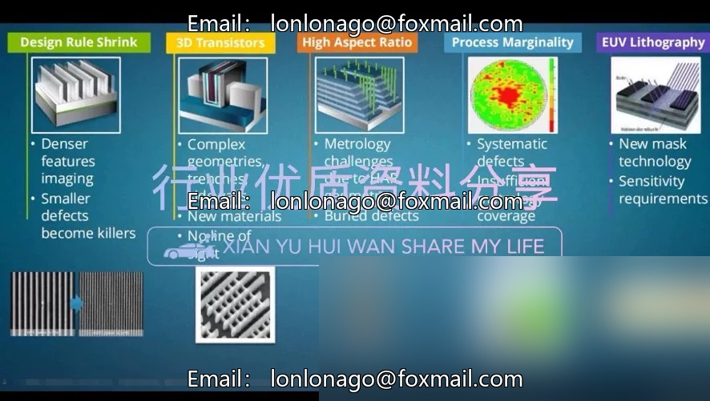
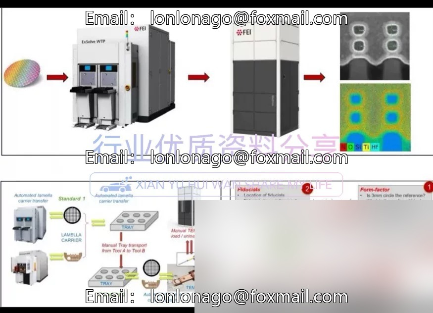
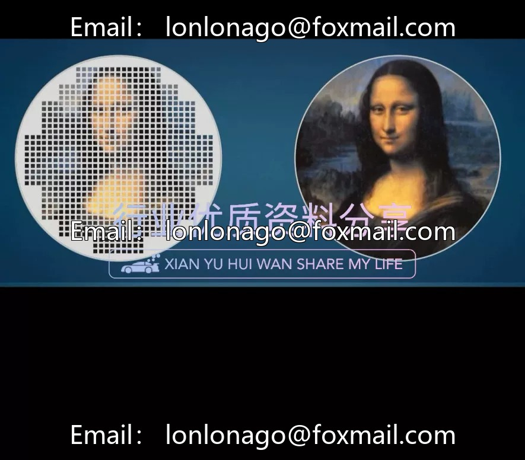
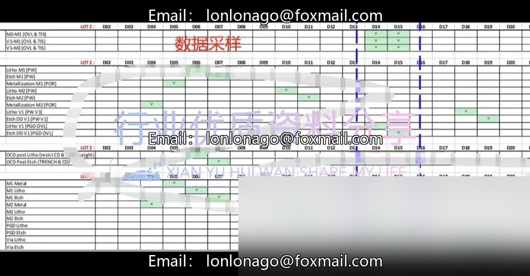
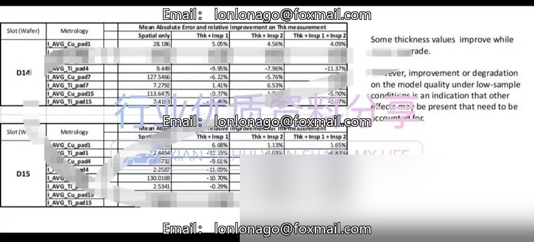
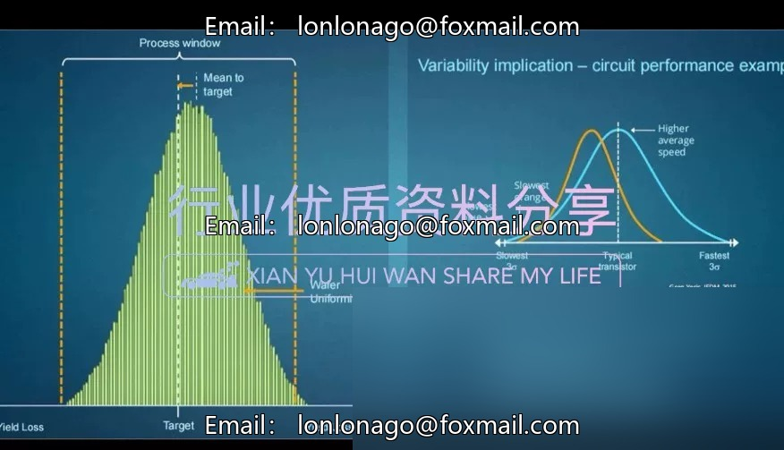

# # Electronic data AMAT application material wafer detection technology: 110 pages of wafer detection

## Body

# AMAT application material wafer detection technology: technical materials of 110 pages on wafer detection and measuring technology, from AMAT company's detection technology training materials! Mainly focused on development challenges of detection and new technology introductions! There are many data structures. Very profound materials

Capture and send the electronic original directly! The following images include screenshots of the file portion. Please confirm before placing the order! Due to the replicable nature of electronic documentation Therefore, are allowed after purchase! Thanks for understanding!

For personal learning and reference use only.

This is AMAT's 110-page technology on wafer detection and metrology, covering chip detection, metrology, data structures, and topics including design rule shrink, 3D transistors, EUV lithography, defects, imaging and more.

<!-- AI_ENRICHED -->

## Images

## Payment

Here is a pay link on Stripe ( https://buy.stripe.com/3cs8yP7sY87d0vu9AB ). Please contact me lonlonago@foxmail.com after funding $89, and I will send you a complete data files , thank you!

